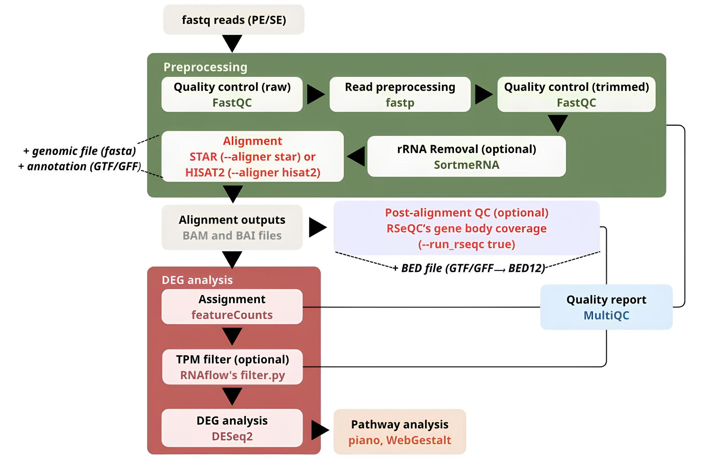

# Extended RNAflow: A Nextflow Pipeline for Bulk RNA-seq Differential Gene Expression Analysis

An extended version of [RNAflow](https://github.com/hoelzer-science/rnaflow), developed to provide **alternative splice-aware read alignment with STAR or HISAT2** and **additional post-alignment RNA-seq quality assessment with RSeQC**. The workflow retains the core RNAflow approach to preprocessing, gene-level quantification, differential expression analysis, and reporting.

> [!IMPORTANT]
> **Execution environment:** This extended pipeline was developed and run using **Docker**. **Conda and Singularity/Apptainer are not yet supported or validated for the newly developed STAR and RSeQC functionality.** Please use the Docker profile for workflows that enable these extensions. This limitation concerns the extended implementation, not necessarily the upstream RNAflow project.

## Origin and attribution

This repository is a derivative of **RNAflow** by the Hoelzer laboratory. For the original project's features, documentation, citation instructions, and history, please see **[the original RNAflow repository](https://github.com/hoelzer-science/rnaflow)**.

- Upstream RNAflow baseline used for development: `f2d26a3418adc10d24b5042ad653081a9500245b`.

This README describes the extended differential-expression workflow. Other features inherited from upstream RNAflow, including transcriptome assembly, are not re-documented here; refer to the upstream project.

## Pipeline overview



*Pipeline overview showing the STAR/HISAT2 alignment options and RSeQC Gene Body Coverage. Additional RSeQC modules are described below but are not shown individually in this diagram.*

The analysis proceeds through:

1. **Preprocessing:** FastQC on raw reads → fastp trimming/filtering → FastQC on processed reads; optional SortMeRNA rRNA removal.
2. **Alignment:** choose HISAT2 (original/default) or STAR (added), using a genome FASTA and gene annotation; produce sorted BAM and index files.
3. **Post-alignment QC (optional):** invoke RSeQC analyses on alignment files, using suitable reference/annotation inputs where required.
4. **Quantification and expression:** featureCounts → optional TPM-based filtering → DESeq2 differential expression analysis.
5. **Downstream analysis and reporting:** inherited piano/WebGestalt pathway analysis options and MultiQC summaries, where supported by the chosen workflow.

## What's new in this extension?

### Optional STAR alignment

The original HISAT2 alignment branch is retained, while `--aligner star` selects an alternative STAR alignment branch. The genome index is generated for the selected aligner, and aligned data are passed to the existing downstream quantification and DEG analysis stages.

| Parameter | Meaning | Default / behavior |
| --- | --- | --- |
| `--aligner hisat2` | Use the original HISAT2 alignment branch | **Default** if omitted |
| `--aligner star` | Use the added STAR alignment branch | Opt-in |

### Optional RSeQC modules (original paper: https://academic.oup.com/bioinformatics/article/28/16/2184/325191)

Some RSeQC analyses (https://rseqc.sourceforge.net/) are controlled by the pipeline-level flag `--run_rseqc true`. When the flag is `false` or omitted, the added RSeQC workflow is skipped.

| RSeQC module / tool | Purpose | Key inputs and applicability |
| --- | --- | --- |
| `bam_stat.py` | Summary of alignment composition and mapping characteristics | Alignment BAM |
| `read_duplication.py` | Estimates read duplication characteristics | Alignment BAM |
| `geneBody_coverage.py` | Normalized 5′–3′ gene-body coverage; detects potential positional bias | Alignment BAM and transcript/gene-model BED |
| `infer_experiment.py` | Infers library strandedness/orientation | Alignment BAM and reference gene-model BED |
| `read_distribution.py` | Summarizes read assignment across annotated genomic features | Alignment BAM and compatible BED annotation |
| `junction_saturation.py` | Assesses how splice-junction discovery changes with read subsampling | Spliced alignment BAM and compatible gene-model annotation; dependent on installed RSeQC version |
| `inner_distance.py` | Estimates the inner distance between paired reads | **Paired-end** alignment BAM and compatible BED annotation; not applicable to single-end libraries |

**Annotation preparation:** The development discussions describe GTF-to-BED conversion using `gtfToGenePred` and `genePredToBed` / equivalent implemented conversion utilities. Ensure the required executable(s) exist in the Docker image and that the resulting annotation has the expected BED12 format before enabling annotation-dependent analyses. The exact conversion process and file names should be checked against the current module scripts. A generic `gtf2bed.py` command must **not** be assumed to be present in every RSeQC image.

**Interpretation notes:** Gene-body bias can reflect library design, mRNA enrichment, degradation, or other technical effects; it is not automatically evidence of poor sequencing. Similarly, duplication and junction saturation depend on sequencing depth, library type, and genome/annotation characteristics.

## Requirements

- Linux environment with a working **Docker daemon** and permission to run containers.
- **Nextflow** and a compatible Java runtime installed on the host.
- Sufficient disk space for FASTQ files, indices, intermediate BAMs, Nextflow `work/`, and results.
- Reference genome FASTA and matching gene annotation GTF/GFF for the organism being analyzed, unless using a supported upstream RNAflow download option.

**Development environment (not minimum system requirements):** Ubuntu 20.04.6 LTS (x86_64); 16 logical CPUs; 64 GB RAM; Nextflow 23.04.3; OpenJDK 11.0.13; Docker 28.1.1. The implemented tools included STAR 2.7.11b and RSeQC 4.0.0. Resource needs vary considerably with genome size, sample count, and selected modules. STAR genome indexing/alignment can require substantially more RAM than HISAT2.

## Quick start (Docker)

Run these commands **from the root directory of the cloned extended repository**, not from the upstream RNAflow repository:

```bash
# Verify the execution environment
nextflow -version
docker --version
docker info

# Inspect the available arguments in this checkout
nextflow run . --help

# Run the extended workflow on prepared input files
nextflow run . -profile docker,local \
  --reads samples.csv \
  --genome genome_files.csv \
  --aligner star \
  --run_rseqc true \
  --max_cores 6 \
  --cores 6 \
  -resume
```

The `-profile docker,local` syntax, `--reads`, `--genome`, `--annotation`, `--max_cores`, and `--cores` options follow the RNAflow upstream CLI. The added flags `--aligner` and `--run_rseqc` are documented in the thesis. **Review your local `nextflow.config`, `main.nf`, and `--help` output before running:** this README was prepared from development notes and upstream documentation; the exact current contents of your modified repository were not supplied for code-level verification.

To use the HISAT2 branch, substitute `--aligner hisat2` or omit `--aligner`. To skip RSeQC, use `--run_rseqc false` or omit the flag.

### Input samplesheet

RNAflow's original `--reads` format is CSV with this exact header:

```csv
Sample,R1,R2,Condition,Source,Strandedness
control_1,/absolute/path/control_1_R1.fastq.gz,/absolute/path/control_1_R2.fastq.gz,control,,0
control_2,/absolute/path/control_2_R1.fastq.gz,/absolute/path/control_2_R2.fastq.gz,control,,0
treated_1,/absolute/path/treated_1_R1.fastq.gz,/absolute/path/treated_1_R2.fastq.gz,treated,,0
treated_2,/absolute/path/treated_2_R1.fastq.gz,/absolute/path/treated_2_R2.fastq.gz,treated,,0
```

- `Sample`: unique sample label.
- `R1`, `R2`: FASTQ paths. For single-end samples, leave `R2` blank.
- `Condition`: experimental group for DEG comparisons. The upstream workflow expects at least two replicates per condition.
- `Source`: optional sample/patient or paired-design label; leave blank if not applicable.
- `Strandedness`: `0` = unstranded, `1` = forward stranded, `2` = reverse stranded, according to upstream RNAflow's convention. Set this to the actual library type.

All FASTQ and reference paths must be accessible to Docker from the execution host. Use absolute paths where practical. For meaningful biological inference, do not treat independently subsampled FASTQs from the same library as independent biological replicates.

### Reference files

The upstream `--genome` and `--annotation` parameters accept **one file path per line**, for example:

`genome_files.csv`:

```text
/absolute/path/reference_genome.fa
```

`annotation_files.csv`:

```text
/absolute/path/reference_annotation.gtf
```

Use matching genome and annotation releases and compatible sequence naming (e.g., `chr1` versus `1`). Annotation-dependent RSeQC functions require a suitable BED conversion; a GTF file alone is not a direct substitute for the expected RSeQC BED input.

### Optional configuration examples

```bash
# Default/original alignment, with the added RSeQC steps disabled
nextflow run . -profile docker,local \
  --reads samples.csv --genome genome_files.csv --annotation annotation_files.csv \
  --aligner hisat2 --run_rseqc false

# STAR alignment with the optional RSeQC workflow enabled
nextflow run . -profile docker,local \
  --reads samples.csv --genome genome_files.csv --annotation annotation_files.csv \
  --aligner star --run_rseqc true

# Avoid repeating completed tasks when resuming the same run
nextflow run . -profile docker,local \
  --reads samples.csv --genome genome_files.csv --annotation annotation_files.csv \
  --aligner star --run_rseqc true -resume
```

Other inherited upstream RNAflow controls include `--skip_sortmerna`, `--skip_read_preprocessing`, `--deg`, `--tpm`, and `--featurecounts_additional_params`. Refer to the [original RNAflow documentation](https://github.com/hoelzer-science/rnaflow) for their full usage and semantics; do not assume the same defaults in every custom revision.

## Expected outputs and quality-control guidance

Output paths depend on the current workflow implementation and configured results directory. Look for the following **types** of results rather than treating the illustrative labels below as guaranteed exact folder names:

| Stage | Outputs / checks |
| --- | --- |
| FastQC / fastp | Raw and trimmed read quality, adapters, trimming statistics |
| SortMeRNA, if enabled | rRNA filtering logs / processed reads |
| HISAT2 or STAR | Alignment log/summary, coordinate-sorted BAM and BAI |
| RSeQC `bam_stat` | Alignment summary statistics |
| RSeQC `read_duplication` | Duplicate-read metrics and associated plots/data |
| RSeQC `geneBody_coverage` | Gene-body coverage tables and/or plots from 5′ to 3′ |
| RSeQC `infer_experiment` | Estimates of read orientation relative to annotated genes |
| RSeQC `read_distribution` | Distribution across exonic, intronic, and other annotated regions |
| RSeQC `junction_saturation` | Splice-junction saturation output/plots |
| RSeQC `inner_distance` | Paired-read insert/inner-distance distribution |
| featureCounts | Gene-level count matrix and assignment summary |
| DESeq2 | Differential gene-expression tables and diagnostic plots |
| MultiQC | Combined QC report for supported tools and formats |

**MultiQC coverage depends on its version and parser compatibility.** Do not presume every RSeQC module appears automatically in MultiQC unless its output has been explicitly incorporated and tested. Individual RSeQC result files can remain useful even if absent from the combined MultiQC report.

### Basic QC interpretation

1. Review raw and trimmed FastQC/fastp plots before evaluating downstream alignment quality.
2. Check aligner summaries, uniquely mapped reads, and assignment percentages; unexpected changes can signal a mismatched genome/annotation or unsuitable read inputs.
3. Compare gene-body coverage **across comparable library preparations** and alongside other QC metrics.
4. Examine `infer_experiment` before assuming the correct strandedness setting for featureCounts.
5. Apply `inner_distance` only when the library is paired-end; interpret duplication and junction saturation relative to library preparation and sequencing depth.
6. Inspect the DESeq2 design, biological replication, and count filtering before interpreting DEGs.

## Troubleshooting

**Docker process fails or cannot access files.** Confirm Docker is running (`docker info`) and that all FASTQ, genome, and annotation paths are readable from the host and accessible to Docker. Ensure sufficient storage for `work/` and image pulls.

**STAR index fails or the process is killed.** Examine RAM use and Nextflow process logs. Whole-genome STAR indices can demand substantially more memory than HISAT2 indices; use appropriately sized hardware and check process resource limits.

**An RSeQC module reports a missing BED or conversion command.** Verify that GTF-to-BED conversion ran successfully, that BED12 features are compatible with the RSeQC tool, and that conversion executables are installed in the **actual Docker image used by the process**. Do not rely on a conversion executable from the host being present inside the container.

**`--run_rseqc false` still causes an RSeQC process/output error.** In Nextflow, outputs of skipped processes must not be referenced unconditionally. Inspect module wiring for conditional invocation and initialized empty channels. This is a development/debugging check rather than a user-facing option.

**RSeQC plots missing from MultiQC.** Look for the original RSeQC files first; MultiQC integration may require per-module parser support, naming conventions, or explicitly included result channels.

**Conda/Singularity execution fails.** For extended STAR/RSeQC operations, switch to the tested `-profile docker,local` configuration. The extended modules have not yet been adapted and validated for these alternate environments.

**Cannot resume a previous analysis.** Use `-resume` from the same project execution context with access to the previous Nextflow cache and `work/` directory. Changed inputs or scripts may correctly trigger re-execution.

## Reproducibility and limitations

- Record the current Git commit, Nextflow version, Docker images and tags/digests, command line, reference genome/annotation release, and relevant input metadata in each analysis.
- **Docker-only for the extension:** the additional STAR/RSeQC features have not been validated under Conda or Singularity/Apptainer.
- **Module availability can vary by development revision:** confirm the RSeQC processes enabled in the checked-out workflow before running.
- **Not all extra QC modules are appropriate for every library:** e.g., paired-read inner distance requires paired-end data, while gene-body coverage is library-design-dependent.
- Recheck workflow flags and paths against the current checkout before relying on these instructions, since the complete developed repository code was not supplied when drafting this README.

## Citation and license

This project builds on the original [RNAflow repository](https://github.com/hoelzer-science/rnaflow). Please cite RNAflow and the relevant third-party tools according to the upstream project's [citation guidance](https://github.com/hoelzer-science/rnaflow/blob/master/citations.md).

The upstream RNAflow repository is licensed under **GPL-3.0**. Retain the upstream license file and applicable attribution/notices in the derivative repository; see [`LICENSE`](LICENSE) for the repository's applicable license text.
